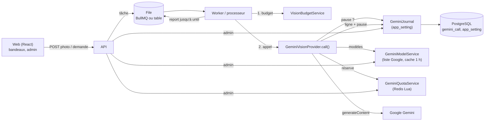

# Approche IA (Gemini) : guide réutilisable

Comment Ma Cave appelle Google Gemini sans jamais bloquer l'utilisateur, sans
dépasser les quotas et en gardant la trace de chaque appel. Ce guide sert à
reproduire la même approche dans un autre projet (monorepo NestJS/React, app
Bun/Express + React + Prisma…). Les extraits sont tirés du code réel,
raccourcis.

## 1. Principes

1. **L'IA ne bloque jamais l'utilisateur.** Tout travail IA passe par une file
   (BullMQ ou table en base). Une panne passagère (429, 5xx, réseau, pause,
   budget, clé mal configurée) **reporte** la tâche ; seules les erreurs
   nommées comme définitives (réponse inexploitable) la font échouer. Une
   erreur inconnue est passagère par défaut.
2. **Modèles légers seulement** (Flash, Flash-Lite), jamais Pro : refusé au
   démarrage (`.env`) et à l'administration. Les modèles ne sont **pas fixés
   dans `.env`** : l'application lit la **liste en direct de Google**, garde
   les Flash/Lite stables, les classe du plus récent au plus ancien et les
   affiche dans l'administration. `GEMINI_MODEL` n'est qu'un repli si la liste
   est indisponible.
3. **Quotas respectés avant l'appel** : limiteur local **par modèle**
   (requêtes/minute, jetons/minute, requêtes/jour), jour compté au **fuseau du
   Pacifique** comme Google. Quota du jour atteint : **bascule** aussitôt vers
   le modèle suivant.
4. **Pause commune** (api + worker) après un 429 ou un 503 de Google, d'une
   durée lue dans la réponse (`retryDelay`, « retry in 37s », quota du jour →
   minuit du Pacifique), jamais raccourcie.
5. **Messages à l'utilisateur avec l'heure de reprise**, arrondie à la minute
   supérieure, avec le **jour nommé** (« jeudi à 09:00 »), jamais « demain ».
6. **Journal de chaque requête envoyée** (usage, issue, statut HTTP, modèle,
   coût, durée) et **budget mensuel** vérifié avant l'appel. Les jetons de
   chaque réponse alimentent le limiteur.
7. **JSON demandé par la consigne** + `responseMimeType: 'application/json'`,
   **sans `responseSchema` imbriqué** (Google le refusait en 400).
8. **Validation stricte côté serveur** de la réponse (zod, indices de lot
   vérifiés) : rien n'est cru sur parole.
9. **Aucun appel réel à Gemini dans les tests** : faux modèle injecté, horloge
   injectée, faux Prisma ; Redis réel local pour le limiteur.
10. **Rien d'annexe ne casse un appel** : journal, limiteur ou pause
    illisibles (base ou Redis en panne) sont journalisés et l'appel part.

## 2. Architecture



Flux d'un appel (`GeminiVisionProvider.call`) :

1. `journal.assertNotPaused()` : pause commune en cours → `GeminiPausedError(until)`, rien n'est envoyé.
2. Pour chaque modèle de `models.candidates()` (ordre d'emploi) :
   1. `quota.reserve(model)` (script Lua atomique) : refus → `GeminiQuotaError(until, QUOTA_MINUTE|QUOTA_TOKENS|QUOTA_JOUR)`.
   2. `generateContent` ; puis `quota.addTokens(model, entrée + sortie)`.
   3. Réponse parsée et validée ; `journal.record({ outcome: 'OK', model, costCents, durationMs })`.
   4. Échec : `journal.record({ outcome: 'REFUSE'|'ERREUR' })` ; 429/503 → pause commune ; 429 **journalier** → modèle marqué épuisé, sans pause commune.
   5. `QUOTA_JOUR` → modèle suivant (bascule) ; autre erreur → remonte.
3. Le processeur classe l'erreur : `GeminiPausedError`/budget → report jusqu'à `until` sans consommer de tentative ; passagère → report croissant ; définitive → échec, saisie manuelle proposée.

## 3. Briques

### 3.1 Règle « modèle léger » (env)

`api/src/config/env.ts`

```ts
export const isLightModel = (model: string): boolean =>
  /^[a-z0-9.-]+$/i.test(model) && /flash|lite|light/i.test(model) && !/pro/i.test(model);
const lightModel = z.string().refine(isLightModel, { message: 'seuls les modèles Gemini Flash ou Lite sont acceptés' });

const schema = z.object({
  GEMINI_API_KEY: z.string().default(''),
  GEMINI_MODEL: lightModel.default('gemini-3.8-flash'),       // repli seulement
  GEMINI_MONTHLY_CAP_CENTS: z.coerce.number().int().default(500),
});
```

Le nom part dans une adresse Google : caractères limités. Un `GEMINI_MODEL=…-pro` fait échouer le démarrage.

### 3.2 Liste des modèles depuis Google, ordre d'emploi

`api/src/vision/gemini-model.service.ts`

```ts
const LIST_URL = 'https://generativelanguage.googleapis.com/v1beta/models';
const STABLE = /^gemini-(\d+(?:\.\d+)*)-flash(-lite)?$/;   // écarte preview, exp, tts, image, live…
export const isStableModel = (name: string) => STABLE.test(name) && isLightModel(name);

/** Du plus récent au plus ancien, Flash avant Flash-Lite à version égale. */
export function fallbackModels(available: string[]): string[] {
  const rank = (m: string) => { const [, v, lite] = STABLE.exec(m)!; return { v: v.split('.').map(Number), lite: lite ? 1 : 0 }; };
  return [...new Set(available)].filter(isStableModel).sort((a, b) => {
    const [ra, rb] = [rank(a), rank(b)];
    for (let i = 0; i < Math.max(ra.v.length, rb.v.length); i++) {
      const d = (rb.v[i] ?? 0) - (ra.v[i] ?? 0);
      if (d) return d;
    }
    return ra.lite - rb.lite;
  });
}

private async fetchModels(): Promise<string[]> {
  const names = new Set<string>();
  let pageToken = '';
  do {
    const url = new URL(LIST_URL);
    url.searchParams.set('pageSize', '1000');
    if (pageToken) url.searchParams.set('pageToken', pageToken);
    // Clé en en-tête, pas dans l'adresse : elle ne finit pas dans un message d'erreur.
    const res = await this.fetch(url, { headers: { 'x-goog-api-key': this.apiKey }, signal: AbortSignal.timeout(10_000) });
    if (!res.ok) throw new Error(`Google a répondu ${res.status}`);
    const page = await res.json();
    for (const m of page.models ?? []) {
      const name = (m.name ?? '').replace(/^models\//, '');
      if (isStableModel(name) && m.supportedGenerationMethods?.includes('generateContent')) names.add(name);
    }
    pageToken = page.nextPageToken ?? '';
  } while (pageToken);
  return [...names].sort();
}
```

Cache : succès 1 h, échec 1 min (l'admin ne subit pas le délai de Google à
chaque page). Échec : `[GEMINI_MODEL]` s'il est stable, et l'erreur est
renvoyée à l'admin. `candidates()` = `fallbackModels(available().models)`, lu
**à chaque appel**.

### 3.3 Limiteur Redis par modèle (fenêtre glissante + compteur du jour)

`api/src/vision/gemini-quota.ts`. Clés par modèle :
`gemini-quota:<modèle>:rpm` (ZSET, score = instant),
`:tpm` (ZSET, membre `uuid:jetons`), `:rpd:<jour du Pacifique>` (compteur),
`:epuise` (marque posée après un 429 journalier, expire à minuit Pacifique).

```ts
export const DEFAULT_LIMITS = { rpm: 5, tpm: 250_000, rpd: 20 };   // niveau gratuit
const WINDOW_MS = 60_000, MARGIN_MS = 1000, WINDOW_TTL_S = 120, DAY_TTL_S = 26 * 3600;

// KEYS: rpm, tpm, rpd, épuisé. ARGV: now, rpm, tpm, rpd, id, dryRun.
// Rend {0} place prise, {3} jour, {1|2, instant} : place libre quand cette entrée sort de la fenêtre.
const RESERVE = `
local now = tonumber(ARGV[1])
local from = now - ${WINDOW_MS}
redis.call('ZREMRANGEBYSCORE', KEYS[1], '-inf', from)
redis.call('ZREMRANGEBYSCORE', KEYS[2], '-inf', from)
if redis.call('EXISTS', KEYS[4]) == 1 then return {3} end
if tonumber(redis.call('GET', KEYS[3]) or '0') + 1 > tonumber(ARGV[4]) then return {3} end
if redis.call('ZCARD', KEYS[1]) + 1 > tonumber(ARGV[2]) then
  return {1, tonumber(redis.call('ZRANGE', KEYS[1], 0, 0, 'WITHSCORES')[2])}
end
local entries = redis.call('ZRANGE', KEYS[2], 0, -1, 'WITHSCORES')
local sum = 0
for i = 1, #entries, 2 do sum = sum + tonumber(string.match(entries[i], ':(%d+)$')) end
local tpm = tonumber(ARGV[3])
if sum >= tpm then
  for i = 1, #entries, 2 do
    sum = sum - tonumber(string.match(entries[i], ':(%d+)$'))
    if sum < tpm then return {2, tonumber(entries[i + 1])} end
  end
end
if ARGV[6] == '1' then return {0} end
redis.call('ZADD', KEYS[1], now, ARGV[5])
redis.call('EXPIRE', KEYS[1], ${WINDOW_TTL_S})
redis.call('INCR', KEYS[3])
redis.call('EXPIRE', KEYS[3], ${DAY_TTL_S})
return {0}`;

private async check(model: string, now: Date, dryRun: boolean) {
  const limits = await this.limits(model);
  const [code, at] = (await this.redis.eval(RESERVE, 4, ...this.keys(model, now),
    now.getTime(), limits.rpm, limits.tpm, limits.rpd, randomUUID(), dryRun ? 1 : 0)) as number[];
  if (code === 3) return new GeminiQuotaError(nextPacificMidnight(now), 'QUOTA_JOUR', limits.rpd, now);
  const until = new Date(at + WINDOW_MS + MARGIN_MS);
  if (code === 1) return new GeminiQuotaError(until, 'QUOTA_MINUTE', limits.rpm, now);
  if (code === 2) return new GeminiQuotaError(until, 'QUOTA_TOKENS', limits.tpm, now);
  return null;
}

async reserve(model: string, now = new Date(this.clock())) {
  let refusal;
  try { refusal = await this.check(model, now, false); }
  catch (e) { this.log.error(`Limiteur Gemini injoignable, appel envoyé : ${messageOf(e)}`); return; }
  if (refusal) throw refusal;
}

/** Après la réponse : jetons réels (entrée + sortie). */
async addTokens(model: string, tokens: number, now = new Date(this.clock())) {
  if (!(tokens > 0)) return;
  const [, key] = this.keys(model, now);
  await this.redis.multi().zadd(key, now.getTime(), `${randomUUID()}:${Math.round(tokens)}`).expire(key, WINDOW_TTL_S).exec();
}

/** 429 journalier de Google : modèle refusé jusqu'à minuit Pacifique. */
async markExhausted(model: string, now = new Date(this.clock())) {
  await this.redis.set(this.keys(model, now)[3], '1', 'PX', Math.max(1, nextPacificMidnight(now).getTime() - now.getTime()));
}

private keys(model: string, now: Date): [string, string, string, string] {
  const p = `${this.prefix}:${model}`;
  return [`${p}:rpm`, `${p}:tpm`, `${p}:rpd:${pacificDay(now)}`, `${p}:epuise`];
}
```

Points clés : le jour est vérifié en premier (attente la plus longue) ; les
jetons ne sont connus qu'après la réponse, donc ajoutés après coup ;
`blocked(models)` fait un essai à blanc (`dryRun`) en suivant la bascule,
pour afficher l'attente dans l'admin sans rien consommer. Connexion Redis
dédiée : `new Redis(url, { lazyConnect: true, maxRetriesPerRequest: 1 })`
(une seule tentative : Redis en panne ne retient pas l'appel).

### 3.4 Réglages en base avec cache 30 s

Même fichier. Limite d'un modèle = `gemini_rpm:<modèle>`, sinon `gemini_rpm`
(commun), sinon défaut. API et worker relisent au plus 30 s après un
changement.

```ts
const LIMITS_TTL_MS = 30_000;
async limits(model: string): Promise<GeminiLimits> {
  const now = this.clock();
  const cached = this.cached.get(model);
  if (cached && now - cached.at < LIMITS_TTL_MS) return cached.value;
  const own = [`gemini_rpm:${model}`, `gemini_tpm:${model}`, `gemini_rpd:${model}`];
  const common = ['gemini_rpm', 'gemini_tpm', 'gemini_rpd'];
  try {
    const rows = await this.prisma.appSetting.findMany({ where: { key: { in: [...own, ...common] } } });
    const read = (i: number, fallback: number) => {
      for (const key of [own[i], common[i]]) {
        const n = Number(rows.find((r) => r.key === key)?.value);
        if (Number.isInteger(n) && n >= 1) return n;   // illisible : réglage suivant
      }
      return fallback;
    };
    const value = { rpm: read(0, 5), tpm: read(1, 250_000), rpd: read(2, 20) };
    this.cached.set(model, { value, at: now });
    return value;
  } catch (e) {
    return cached?.value ?? DEFAULT_LIMITS;            // base en panne : dernières connues
  }
}
```

### 3.5 Choix du modèle, bascule, journal (point de passage unique)

`api/src/vision/gemini-vision.provider.ts` : **toutes** les méthodes publiques
passent par `call(usage, run)`.

```ts
private async call<T extends { costCents: number }>(usage: GeminiUsage, run: (model: Model, name: string) => Promise<T>): Promise<T> {
  await this.journal?.assertNotPaused();
  let day: GeminiQuotaError | null = null;
  for (const model of await this.models()) {
    try {
      return await this.attempt(usage, model, run);
    } catch (e) {
      if (!(e instanceof GeminiQuotaError && e.reason === 'QUOTA_JOUR')) throw e;
      day ??= e;                                   // quota du jour : modèle suivant
    }
  }
  throw day ?? new Error('Aucun modèle Gemini Flash ou Flash-Lite stable disponible');
}

private async attempt<T extends { costCents: number }>(usage: GeminiUsage, model: string, run: …): Promise<T> {
  const counted = this.counted(this.modelFor(model), model);
  const started = Date.now();
  let result: T;
  try {
    result = await run(counted, model);
  } catch (e) {
    if (e instanceof GeminiPausedError) throw e;   // refus du limiteur : rien n'est parti, rien n'est noté
    const detail = e instanceof Error ? e.message : String(e);
    const failure = classifyFailure(e);
    const daily = !!this.quota && failure.httpStatus === 429 && isDailyQuota(detail);
    await this.journal?.record({ usage, ...failure, model, durationMs: Date.now() - started }, undefined, detail, !daily);
    if (daily) {
      const now = new Date();
      await this.quota!.markExhausted(model, now);
      throw new GeminiQuotaError(nextPacificMidnight(now), 'QUOTA_JOUR', (await this.quota!.limits(model)).rpd, now);
    }
    throw e;
  }
  await this.journal?.record({ usage, outcome: 'OK', httpStatus: null, reason: null, costCents: result.costCents, model, durationMs: Date.now() - started });
  return result;
}

/** Réserve juste avant l'envoi, compte les jetons juste après. */
private counted(model: Model, name: string): Model {
  const quota = this.quota;
  if (!quota) return model;
  return {
    generateContent: async (...args) => {
      await quota.reserve(name);
      const result = await model.generateContent(...args);
      const u = result.response.usageMetadata;
      await quota.addTokens(name, (u?.promptTokenCount ?? 0) + (u?.candidatesTokenCount ?? 0));
      return result;
    },
  };
}
```

Le constructeur prend `modelFor: (name) => Model` et `models: () => Promise<string[]>` :
c'est ce qui permet d'injecter un faux modèle dans les tests.

### 3.6 Consigne JSON et validation stricte

```ts
const result = await model.generateContent({
  contents: [{ role: 'user', parts: [{ text: PROMPT }, { inlineData: { data: image.toString('base64'), mimeType } }] }],
  generationConfig: { responseMimeType: 'application/json' },     // pas de responseSchema
});
const costCents = costCentsOf(result.response.usageMetadata);
const text = stripFences(result.response.text());                  // retire ```json … ```
let raw: unknown;
try { raw = JSON.parse(text); }
catch { throw new VisionInvalidOutputError('Sortie du modèle invalide (JSON illisible)', costCents); }
try { extraction = parseExtraction(raw); }                          // schéma zod
catch (e) { throw new VisionInvalidOutputError(`Sortie du modèle invalide : ${(e as Error).message}`, costCents); }
```

- La forme est décrite **dans la consigne** (« Réponds UNIQUEMENT par un objet
  JSON strict de cette forme : … », avec un exemple). `responseSchema`
  imbriqué → 400.
- Lots (jusqu'à 8 photos ou 10 demandes par appel) : la consigne exige un
  **tableau numéroté** ; `indexedItems(text, n, key)` refuse longueur ≠ n,
  indice manquant, dupliqué ou hors bornes (`VisionBatchMismatchError`), et
  ramène `{"items": […]}` à son tableau. Lot mélangé → relecture une par une.
- Avec l'outil `googleSearch` (recherche ancrée), pas de `responseMimeType` :
  on extrait le premier `{…}` du texte et on valide l'URL.
- L'erreur « Sortie du modèle invalide » porte son coût : un appel inexploitable
  reste facturé et compté au budget.

### 3.7 Coût et budget

```ts
const PRICE_PER_1K_TOKENS_CENTS = { input: 0.01, output: 0.04 };   // ordre de grandeur Flash
const raw = (u) => ((u?.promptTokenCount ?? 0) / 1000) * 0.01 + ((u?.candidatesTokenCount ?? 0) / 1000) * 0.04;
const costCentsOf = (u) => Math.ceil(raw(u));          // photo : jamais à coût nul
const pairingCostCentsOf = (u) => Math.round(raw(u));  // petits appels texte : arrondi
// Recherche ancrée : max(1, jetons + toolUsePromptTokenCount, nb requêtes × 1,4 ct)
```

`api/src/queue/vision-budget.service.ts` : somme des `cost_cents` du mois
(UTC) sur les tables métier, comparée à `GEMINI_MONTHLY_CAP_CENTS`. Les tâches
secondaires (accords, descriptifs) ne tournent que sous 80 % du plafond ; une
part maximale par cave est réglée dans `app_setting`. Dépassement :
`VisionBudgetExceededError`, traitée comme une pause (report, jamais d'échec).

### 3.8 Pause commune après 429/503

`api/src/vision/gemini-pause.ts` et `gemini-journal.ts`. Stockée dans
`app_setting` (`gemini_pause_until`, `gemini_pause_reason`), donc partagée par
l'api et le worker.

```ts
const RETRY_DELAY = [/"retryDelay"\s*:\s*"(\d+(?:\.\d+)?)s"/, /retry in (\d+(?:\.\d+)?)\s*s/i];
export const isDailyQuota = (detail: string) => /PerDay|per day/i.test(detail);

export function pauseAfter429(detail: string, now: Date): Date {
  if (isDailyQuota(detail)) return nextPacificMidnight(now);
  for (const re of RETRY_DELAY) {
    const m = re.exec(detail);
    if (m) return new Date(now.getTime() + Math.ceil(Number(m[1]) * 1000));
  }
  return new Date(now.getTime() + 60 * 60_000);          // 1 h sans indication
}
// 503 : 5 min.

async extendPause(httpStatus: number, now = this.clock(), detail = '') {
  const until = httpStatus === 429 ? pauseAfter429(detail, now) : new Date(now.getTime() + 5 * 60_000);
  await this.prisma.$transaction(async (tx) => {
    await tx.$executeRaw`INSERT INTO app_setting (key, value) VALUES ('gemini_pause_until', '') ON CONFLICT (key) DO NOTHING`;
    const [row] = await tx.$queryRaw<{ value: string }[]>`SELECT value FROM app_setting WHERE key = 'gemini_pause_until' FOR UPDATE`;
    const current = new Date(row?.value ?? '');
    if (!Number.isNaN(current.getTime()) && current >= until) return;   // jamais raccourcie
    await tx.appSetting.update({ where: { key: 'gemini_pause_until' }, data: { value: until.toISOString() } });
    await tx.appSetting.upsert({ where: { key: 'gemini_pause_reason' }, create: { … }, update: { … } });
  });
}
```

Le statut HTTP n'est pas exposé par `@google/generative-ai` : il est lu dans
le message (`[503 Service Unavailable]`), premier `[\d{3}` trouvé.

### 3.9 Jour du Pacifique et texte de reprise

```ts
export const QUOTA_TIME_ZONE = 'America/Los_Angeles';
export const pacificDay = (now: Date) => new Intl.DateTimeFormat('en-CA', { timeZone: QUOTA_TIME_ZONE }).format(now);

/** Prochain minuit Pacifique, heure d'été comprise : décalage lu à 08:00 UTC du jour visé (avant 2 h là-bas). */
export function nextPacificMidnight(now: Date): Date {
  const wall = new Date(pacificWallAsUtc(now.getTime()));
  const target = Date.UTC(wall.getUTCFullYear(), wall.getUTCMonth(), wall.getUTCDate() + 1);
  const probe = target + 8 * 3_600_000;
  return new Date(target - (pacificWallAsUtc(probe) - probe));
}

/** « à 14:04 », « aujourd'hui à 09:00 » ou « jeudi à 09:00 » (heure locale de l'utilisateur). */
function resumeAt(until: Date, now: Date, sameDayWord: boolean): string {
  const shown = new Date(Math.ceil(until.getTime() / 60_000) * 60_000);   // jamais plus tôt que la vraie
  const hour = parisTime.format(shown);
  if (parisDay.format(shown) !== parisDay.format(now)) return `${parisWeekday.format(shown)} à ${hour}`;
  return sameDayWord ? `aujourd'hui à ${hour}` : `à ${hour}`;
}
```

`pacificWallAsUtc(t)` relit l'heure murale du Pacifique (`formatToParts`,
`hourCycle: 'h23'`) comme si c'était de l'UTC.

### 3.10 Classification passagère / définitive

`api/src/queue/transient-failure.ts`

```ts
const TRANSIENT_STATUS = [429, 500, 502, 503, 504];
export const TRANSIENT_NETWORK = ['fetch failed', 'ECONNRESET', 'ECONNREFUSED', 'ETIMEDOUT', 'EAI_AGAIN', 'ENOTFOUND', 'socket hang up', 'other side closed', 'terminated'];
const CONFIGURATION = ['API key not valid', 'API_KEY_INVALID', 'API key expired', 'PERMISSION_DENIED', 'has not been used in project', 'is not found for API version'];
const DEFINITIVE = ['Sortie du modèle invalide', ...CONFIGURATION];

export const statusFromMessage = (m: string) => { const x = /\[(\d{3})\b/.exec(m); return x ? Number(x[1]) : null; };

export function isTransientVisionFailure(error: unknown): boolean {
  if (error instanceof VisionBudgetExceededError) return true;
  if (error instanceof GeminiPausedError) return true;        // inclut GeminiQuotaError
  const message = error instanceof Error ? `${error.name}: ${error.message}` : String(error);
  if (DEFINITIVE.some((n) => message.includes(n))) return false;
  const status = statusFromMessage(message);
  if (status !== null) return TRANSIENT_STATUS.includes(status);
  return true;                                                  // inconnue : passagère
}
```

Les erreurs de configuration sont définitives pour un réessai immédiat mais,
pour les tâches de fond, la donnée est **reportée** (`isConfigurationError`)
avec « service de lecture mal configuré (clé Gemini à vérifier), reprise
automatique ». `deferralReason(e)` traduit l'erreur brute du SDK en phrase
lisible ; le texte brut reste dans les logs.

### 3.11 Report d'une tâche jusqu'à l'heure de reprise

**BullMQ** (`api/src/queue/extraction.queue.ts`, `api/src/worker.ts`) :

```ts
export const EXTRACTION_ATTEMPTS = 1000;              // ~10 jours au plafond de 15 min
export const extractionBackoffDelay = (n: number) => Math.min(30_000 * 2 ** Math.max(0, n - 1), 15 * 60_000);

export function deferredBackoffDelay(attemptsMade: number, error: unknown, now = new Date()): number {
  if (error instanceof GeminiPausedError) return Math.max(0, error.until.getTime() - now.getTime()) + 1000;
  return extractionBackoffDelay(attemptsMade);
}

// File : backoff nommé, résolu côté worker (on change la patience sans toucher aux tâches en file).
new Queue(name, { defaultJobOptions: { attempts: EXTRACTION_ATTEMPTS, backoff: { type: 'reprise-differee' } } });
new Worker(name, handler, {
  settings: { backoffStrategy: (attemptsMade, _type, err) => deferredBackoffDelay(attemptsMade, err) },
});
```

Le processeur remet la donnée en `PENDING` avec `errorMessage = deferralReason(e)`
puis relance l'erreur (BullMQ réessaie) ; erreur définitive →
`throw new UnrecoverableError(message)`. Exception : une lecture **interactive**
(l'utilisateur attend devant l'écran) échoue tout de suite pendant une pause,
avec son message, et l'écran propose l'alternative manuelle.

**Table en base comme file** (photos d'entrée, accords, descriptifs :
`api/src/queue/entry-batch.processor.ts`, `api/src/pairing/generation-batch.processor.ts`) :
une boucle toutes les 15 s réserve un lot avec `FOR UPDATE SKIP LOCKED` sur
`status = 'PENDING' AND reserved_until IS NULL AND (next_attempt_at IS NULL OR next_attempt_at <= now)`.

```ts
if (error instanceof GeminiPausedError || error instanceof VisionBudgetExceededError) {
  await write(request, {
    status: 'PENDING', reservedUntil: null,
    nextAttemptAt: error instanceof GeminiPausedError ? error.until : new Date(now.getTime() + MAX_DELAY_MS),
    errorMessage: deferralReason(error),            // aucune tentative consommée
  });
} else if (isInvalidAnswer(error)) { /* attempts + 1, échec à la 5e */ }
else { /* passagère : attente croissante, abandon après 7 jours */ }
```

Au démarrage, le worker rattrape les données en attente que Redis a oubliées
(`orphan-recovery.ts`, `requeue*`) et libère les réservations échues.

### 3.12 Administration (API)

`api/src/admin/admin.controller.ts`, `gemini-usage.service.ts`, `dto.ts`

- `GET /api/admin/gemini-quota` : `{ current, minute: { requests, tokens }, dayResetsAt, models: [{ model, requests, limits, exhaustedUntil }], error }`.
- `PUT /api/admin/gemini-quota` `{ model?, rpm, tpm, rpd }` : entiers ≥ 1, modèle
  Flash/Lite stable **présent dans la liste** (sinon 400).
- `GET /api/admin/gemini-usage?days=7|30` : agrégat de `gemini_call` par jour
  et usage (OK, refus 503, refus 429, erreurs, coût), plus l'attente en cours :
  la plus lointaine entre la pause commune et `quota.blocked(models)`.

## 4. Données

```prisma
model AppSetting {            // réglages clé/valeur (texte)
  key   String @id
  value String
  @@map("app_setting")
}

model GeminiCall {            // une ligne par requête réellement envoyée
  id         String   @id @default(uuid())
  createdAt  DateTime @default(now()) @map("created_at")
  usage      String            // LECTURE_ENTREE | ACCORDS | … (CHECK en SQL)
  outcome    String            // OK | REFUSE (429, 503) | ERREUR
  httpStatus Int?     @map("http_status")
  reason     String?           // ≤ 300 caractères
  costCents  Int      @default(0) @map("cost_cents")
  durationMs Int      @map("duration_ms")
  model      String?
  @@index([createdAt])
  @@map("gemini_call")
}
```

```sql
CREATE TABLE "gemini_call" (
  "id" TEXT PRIMARY KEY,
  "created_at" TIMESTAMP(3) NOT NULL DEFAULT (now() AT TIME ZONE 'UTC'),
  "usage" TEXT NOT NULL, "outcome" TEXT NOT NULL, "http_status" INTEGER,
  "reason" TEXT, "cost_cents" INTEGER NOT NULL DEFAULT 0, "duration_ms" INTEGER NOT NULL, "model" TEXT,
  CONSTRAINT "gemini_call_outcome_check" CHECK ("outcome" IN ('OK', 'REFUSE', 'ERREUR')),
  CONSTRAINT "gemini_call_reason_length_check" CHECK ("reason" IS NULL OR char_length("reason") <= 300)
);
CREATE INDEX "gemini_call_created_at_idx" ON "gemini_call"("created_at");
```

Clés `app_setting` : `gemini_pause_until` (ISO), `gemini_pause_reason`,
`gemini_rpm|tpm|rpd[:<modèle>]`, parts de budget. Les jetons ne sont pas
stockés dans `gemini_call` (ils ne vivent que dans Redis, 60 s) : ajouter
`prompt_tokens`/`output_tokens` si l'on veut des statistiques de jetons.

Sur chaque donnée traitée en file (photo, accord, descriptif) : `status`
(`PENDING|PROCESSING|DONE|FAILED`), `attempts`, `next_attempt_at`,
`reserved_until`, `error_message` (texte lisible affiché), `model`,
`cost_cents`, `latency_ms`, et la sortie brute (`raw_extraction` JSONB).
Toutes les dates en UTC.

## 5. Interface

- **Bandeau de file** (`web/src/components/AnalysisQueueBanner.tsx`) :
  « 3 photos en attente d'analyse », sous-titre = dernier `error_message` de
  report (sinon « Analyse automatique dès que le service de lecture
  répond »), lien vers la liste. Sondage toutes les 30 s
  (`GET /api/photos/queue-status` → `{ waiting, oldestWaitingAt, lastReason }`).
  Sans lui, une donnée reportée passe pour perdue.
- **Bandeau d'une analyse** (`web/src/components/AnalysisBanner.tsx`) : état
  `waiting` = `GEMINI_PAUSE` | `QUOTA` | `BUDGET` | `RETRY` | en cours, chacun
  avec sa phrase : « En attente : Gemini est en pause jusqu'à 15:40. »,
  message de quota du serveur, « budget de l'IA atteint ce mois-ci. Nouvel
  essai le 22 oct. à 15:55 », « Nouvel essai à 15:42 (tentative 3 sur 1000) »,
  « Envoyée à l'IA il y a 20 s · résultat attendu d'ici une minute ». Échec :
  raison lisible (`GEMINI`, `REFUS`, `BUDGET`, `ILLISIBLE`…) et bouton
  « Relancer ».
- **Textes de quota** (générés côté serveur, `quotaMessage`) :
  - « Limite de 5 requêtes par minute atteinte : reprise à 14:04. »
  - « Limite de jetons par minute atteinte : reprise à 14:04. »
  - « Quota Gemini du jour atteint (20 requêtes) : reprise jeudi à 09:00. »
  - « Quota Gemini dépassé chez Google : reprise à 14:40. »
- **Admin, carte « Modèle Gemini (automatique) »**
  (`web/src/components/admin/GeminiModelSection.tsx`) : modèle en cours,
  « Cette minute : 2 / 5 requêtes, 12 000 / 250 000 jetons », liste des
  modèles dans l'ordre d'emploi avec « 7 / 20 requêtes aujourd'hui » et badge
  « épuisé jusqu'à 09:00 », boutons radio pour choisir le modèle dont on règle
  les trois limites, erreur de la liste Google affichée. Relue toutes les 30 s.
- **Admin, « Consommation Gemini »**
  (`web/src/components/admin/GeminiUsageSection.tsx`) : 7 ou 30 jours, barres
  empilées par usage, appels OK / refus 503 / refus 429 / erreurs, coût en
  euros, colonne *Modèle*, et l'attente en cours.

## 6. Tests

- **Faux Gemini** : le fournisseur reçoit `modelFor` et `models` ; on injecte
  un objet `{ generateContent: jest.fn() }`.

  ```ts
  const fakeModel = (text: string, usage = { promptTokenCount: 1000, candidatesTokenCount: 200 }) =>
    ({ generateContent: jest.fn().mockResolvedValue({ response: { text: () => text, usageMetadata: usage } }) });
  const gemini = (model, name, journal?) => new GeminiVisionProvider(() => model, async () => [name], journal);
  ```

  Pour une erreur Google, rejeter avec le vrai format du SDK :
  `[GoogleGenerativeAI Error]: Error fetching from https://…:generateContent: [429 Too Many Requests] … "retryDelay":"37s"`.
  La consigne envoyée est vérifiée (`mock.calls[0][0]`) : `responseMimeType`
  présent, pas de `responseSchema`.
- **Faux Prisma** (`api/src/test-utils/fake-gemini-prisma.ts`) : `app_setting`
  en `Map`, `gemini_call` en tableau, `$transaction(fn) => fn(prisma)`,
  `$executeRaw`/`$queryRaw` simulant `ON CONFLICT DO NOTHING` / `FOR UPDATE`.
- **Horloge** : chaque service prend `clock` (ou un `now` en paramètre) ;
  tests aux dates fixes, y compris changements d'heure du Pacifique
  (1er novembre, 8 mars) et minuit à Paris pour l'arrondi.
- **Redis** : le limiteur est testé contre un **Redis réel local**
  (`REDIS_URL`, service Redis en CI), préfixe de clés par processus
  (`test-gemini-quota-${process.pid}`), nettoyé après chaque test. Le script
  Lua est ainsi réellement exécuté.
- **Files** : processeurs testés avec des faux fournisseurs qui lèvent
  `GeminiPausedError`, `GeminiQuotaError`, 503, « Sortie du modèle invalide »,
  et vérifient `status`, `next_attempt_at`, `attempts`, `error_message`.
- **Aucune clé** dans les tests : `GEMINI_API_KEY` vide, aucun appel réseau.

## 7. Porter dans un autre projet

### Checklist ordonnée

1. **Env** : `GEMINI_API_KEY`, `GEMINI_MODEL` (repli, validé `isLightModel`),
   `GEMINI_MONTHLY_CAP_CENTS`. Démarrage refusé si Pro.
2. **Tables** : `app_setting`, `gemini_call` ; colonnes de file sur les
   données traitées (§ 4).
3. **Erreurs** : `GeminiPausedError(until, reason)`, `GeminiQuotaError`
   (sous-classe), `BudgetExceededError`, `InvalidOutputError(costCents)`.
4. **Utilitaires de temps** : `pacificDay`, `nextPacificMidnight`,
   `quotaMessage` (fuseau de l'utilisateur, jour nommé, arrondi minute).
5. **Classification** : `statusFromMessage`, `isTransient…`,
   `isConfigurationError`, `deferralReason`.
6. **Service de modèles** : liste Google filtrée Flash/Lite stable, ordre
   d'emploi, caches 1 h / 1 min, repli `.env`.
7. **Limiteur** par modèle (Redis Lua, ou variante ci-dessous), limites en
   base avec cache 30 s, défauts 5 / 250 000 / 20.
8. **Journal** : `record`, `assertNotPaused`, `extendPause` (verrou de ligne).
9. **Fournisseur** : un seul `call(usage, run)` (pause → modèles → réserve →
   appel → jetons → journal → bascule) ; consignes JSON + `responseMimeType` ;
   validation zod.
10. **Budget** mensuel avant chaque tâche.
11. **File** : BullMQ avec `backoffStrategy` jusqu'à `until`, ou table + boucle.
12. **Rattrapage au démarrage** des tâches orphelines et réservations échues.
13. **API admin** (quota, usage) et **écrans** (carte modèle, consommation,
    bandeaux).
14. **Tests** : faux modèle, faux Prisma, horloge, Redis local.

### Variantes sans Redis/BullMQ (ex. Bun/Express mono-processus)

- **Limiteur en mémoire** (un seul processus) : par modèle, un tableau
  d'instants et un tableau `[instant, jetons]` sur 60 s, un compteur
  `{ jour: pacificDay(now), n }` et un `exhaustedUntil`. Même algorithme que
  le Lua (jour d'abord, `until = plus ancienne entrée + 60 s + 1 s`). Comme
  l'exécution JS est mono-fil, vérifier + réserver sans `await` entre les deux
  suffit à l'atomicité. Perdu au redémarrage : relire le compteur du jour
  depuis `gemini_call` (`count(*) where model = ? and created_at >= minuit Pacifique`)
  pour ne pas repartir à zéro.
- **Limiteur en base** (plusieurs processus sans Redis) : réserver en
  insérant une ligne `gemini_call` « en cours » dans une transaction qui
  verrouille une ligne `app_setting` du modèle (`SELECT … FOR UPDATE`), puis
  compter les lignes des 60 dernières secondes et du jour. Plus lent, mais
  suffisant à quelques requêtes par minute.
- **File en base** : la table métier sert de file (`status`,
  `next_attempt_at`, `reserved_until`, `attempts`), boucle `setInterval` de
  10 à 15 s, réservation `FOR UPDATE SKIP LOCKED` (PostgreSQL) ou, en SQLite,
  `UPDATE … SET reserved_until = ? WHERE id IN (SELECT … LIMIT n) RETURNING *`.
  Pause/quota : `next_attempt_at = until` sans consommer de tentative.
- **NestJS** (monorepo cuisine) : reprendre tel quel `VisionModule` (fabriques
  de `GeminiJournal`, `GeminiModelService`, `GeminiQuotaService`, fournisseur),
  et un worker séparé (`createApplicationContext`) pour les files.
- **Pause commune** : en mono-processus, une variable en mémoire suffit, mais
  la garder dans `app_setting` survit au redémarrage (utile pour un 429
  journalier).

### Pièges rencontrés

- **`responseSchema` imbriqué → 400.** Décrire la forme dans la consigne,
  garder `responseMimeType: 'application/json'`, valider côté serveur ; et
  tolérer les fences ```json, le texte autour de l'objet, et un tableau
  enveloppé dans `{"items": […]}`.
- **Quotas gratuits par modèle : 5 RPM, 250 000 TPM, 20 RPD.** 20 requêtes par
  jour partent vite : regrouper (8 photos ou 10 demandes par appel) et
  basculer de modèle. Les limites changent : les rendre réglables par modèle.
- **Le jour de Google est celui du Pacifique** (minuit = 9 h à Paris l'été,
  selon les heures d'été des deux côtés). Clé du compteur du jour et heure de
  reprise en `America/Los_Angeles`, tests aux changements d'heure.
- **Arrondir l'heure de reprise à la minute supérieure** : « reprise à 14:03 »
  pour une reprise à 14:03:31 fait réessayer l'utilisateur trop tôt. Le report
  de la tâche ajoute aussi 1 s de marge.
- **« demain » devient faux** : le message est stocké sur la donnée et relu
  après minuit. Nommer le jour (« jeudi à 09:00 »), « aujourd'hui » seulement
  pour le même jour.
- **Le statut HTTP n'est que dans le message du SDK** (`[503 …]`, pas en tête) :
  chercher le premier `[\d{3}`.
- **429 journalier ≠ 429 par minute** : `PerDay` dans `quotaId` → modèle
  marqué épuisé jusqu'à minuit Pacifique et bascule, **sans** pause commune
  (sinon tous les modèles s'arrêtent pour rien).
- **Jetons connus seulement après la réponse** : compter ceux d'une réponse
  même inexploitable ; facturer aussi les sorties invalides.
- **Pause raccourcie par un refus plus court** : prendre l'échéance la plus
  lointaine, sous verrou de ligne.
- **Un appel bloqué** : délai global (`Promise.race` avec un `ETIMEDOUT`
  passager) pour libérer le lot.
